# 🛡️ Awesome-AI-Agent-Auditing-Verification 🔍

<p align="center">
  
</p>

<p align="center">
  <a href="https://github.com/ishandutta2007/Awesome-Awesome-Awesome"></a>
  <a href="https://discord.gg/jc4xtF58Ve"></a>
  <a href="https://github.com/ishandutta2007/Awesome-AI-Agent-Auditing-Verification/stargazers"></a>
  <a href="https://github.com/ishandutta2007/Awesome-AI-Agent-Auditing-Verification/network/members"></a>
  <a href="https://github.com/ishandutta2007/Awesome-AI-Agent-Auditing-Verification/issues"></a>
  <a href="https://github.com/ishandutta2007/Awesome-AI-Agent-Auditing-Verification/blob/main/LICENSE"></a>
  <a href="https://github.com/ishandutta2007"></a>
</p>

---

## 🌟 Top AI Agent Auditing & Verification Platforms Ecosystem

> **A curated, comprehensive landscape of Enterprise SaaS Products & Open-Source GitHub Frameworks for AI Agent Evaluation, Behavior Verification, Policy Guardrails, Safety Auditing, Red Teaming, Trajectory Scoring, and Observability.**

📅 **Last updated: October 2026**

As autonomous AI agents, multi-agent orchestrations, and LLM reasoning workflows take over mission-critical business processes, verifying that agents operate strictly within designated safety boundaries, authority policies, and operational constraints is paramount. This repository tracks the leading tools that audit agent decisions, detect behavioural drift and misalignment, score trajectory steps, enforce runtime guardrails, conduct automated adversarial red teaming, and provide independent proof of trustworthiness.

---

## 📑 Table of Contents

- [🌐 Sector Overview & Market Dynamics](#-sector-overview--market-dynamics)
- [🏢 SaaS/Hosted Platforms](#-saashosted-platforms)
- [💻 Open-Source GitHub Projects](#-open-source-github-projects)
- [🛠️ Recommended Architecture & Workflows](#️-recommended-architecture--workflows)
- [📈 Star History](#-star-history)
- [🤝 How to Contribute](#-how-to-contribute)
- [💖 Support & Sponsorship](#-support--sponsorship)
- [⚠️ Disclaimer](#️-disclaimer)

---

## 🌐 Sector Overview & Market Dynamics

The AI observability, evaluation, and agent verification market is currently valued at approximately **$840M to $1.8B** (2025–2026 base years) and is expanding at an impressive CAGR of **22% to 38%** as enterprise adoption transitions from basic chat interfaces to multi-agent production loops. 

The sector remains **highly fragmented** across specialized pure-play LLM evaluation startups, runtime safety guardrail providers, and traditional APM/data monitoring giants—yet it is simultaneously undergoing aggressive **consolidation and M&A** (e.g., Dynatrace acquiring Arize AI for $915M, Snowflake acquiring TruEra, Check Point acquiring Lakera for ~$300M, and Cisco integrating Galileo into Splunk).

---

## 🏢 SaaS/Hosted Platforms

| 🏢 Platform | 💰 Company Size / Valuation & Funding | 🏷️ Pricing (Starting Paid Tier) | 🎁 Free Tier / Trial Limit | 📝 Description |
| :--- | :--- | :--- | :--- | :--- |
| **[Arize AI](https://arize.com/)** | **$915M** (Acquired by Dynatrace; $131M raised prior; ARR ~$10M–$45M) | **$120/mo** (AX Pro / Team tier) | **Free forever plan**: Up to 25,000 trace spans/mo, 1 GB storage, 15-day retention, unlimited online evals. Also open-sources Phoenix (unlimited self-hosted). | ML and LLM observability platform with tracing, evaluation, and monitoring capabilities for production AI systems and agents. |
| **[Braintrust](https://www.braintrust.dev/)** | **$800M** valuation (Series B, $121M+ total raised) | **$249/mo** (Pro tier; includes $100 gateway credit, 5 GB data, 50k scores/mo) | **Free forever plan**: Includes $10/mo model credits, 1 GB processed data/mo, 10,000 scores/mo, and 14-day retention. | Evaluation-first platform for scoring LLM and agent outputs, managing datasets, and running experiments with strong developer workflows. |
| **[Lakera](https://www.lakera.ai/)** | **~$300M** (Acquired by Check Point; $30M venture raised) | **Custom annual/monthly quote** (Enterprise runtime protection) | **Free forever plan (Community)**: 10,000 API requests/month for Lakera Guard runtime protection. | AI security and guardrails platform focused on prompt injection defense, content filtering, and runtime protection for LLM applications and agents. |
| **[Galileo](https://www.rungalileo.io/)** | **~$150M–$200M** est. ($68.1M raised, acquired by Cisco/Splunk) | **$100/mo** (billed annually, or $150/mo monthly for Pro tier; 50,000 traces/mo) | **Free forever plan**: Up to 5,000 traces/month, unlimited users, and unlimited custom evaluations. | LLM and agent evaluation platform with trajectory analysis, automated scoring, and production monitoring focused on agent quality. |
| **[Fiddler AI](https://www.fiddler.ai/)** | **~$120M–$150M** est. ($100M total venture raised) | **$0.002 per trace** (Developer tier for unified observability, testing, and custom judges) | **Free forever plan**: Free real-time guardrails (toxicity, PII, prompt injections, hallucinations via Centor Models; <80ms latency). 10-day trial for companion tools. | Model performance and responsible AI platform providing monitoring, explainability, and governance for ML and generative AI systems. |
| **[Patronus AI](https://www.patronus.ai/)** | **~$100M–$120M** est. ($70M total venture raised through Series B) | **$25/mo** (Base self-serve tier; API usage at $10–$20 per 1k evaluator calls) | **Free forever plan**: $10 in API credits, 2 projects, 5 experiments per project, 14-day retention (or 30,000 scan units/mo for Monitor). | Evaluation and testing platform for LLM applications and agents, emphasizing automated scoring, hallucination detection, and quality assurance. |
| **[Arthur AI](https://www.arthur.ai/)** | **~$65M** venture raised ($43M–$150M historical valuation range) | **Contact Sales / Custom quote** (Premium/Enterprise tiered by monitored models & tokens) | **Free forever plan**: Core metrics and cloud connectors for initial models, plus Arthur Bench is fully open-source with no license limits. | AI performance and monitoring platform focused on model and agent reliability, drift, and operational metrics. |
| **[TruEra](https://truera.com/)** | **~$50M** est. ($43M raised prior to acquisition by Snowflake) | **Custom Enterprise contract** (via Snowflake / Private Offer) | **Free evaluation**: 14-day pilot / sandbox upon sales request; open-source TruLens evaluation library is 100% free with unlimited local runs. | AI quality and observability platform (now part of Snowflake) known for evaluation, diagnostics, and trust metrics for ML systems. |
| **[WhyLabs](https://whylabs.ai/)** | **$37M** valuation ($14M raised; ~$10.6M ARR) | **$125/mo** (Expert tier; up to 5 users, 10 projects, 100M predictions/mo) | **Free forever plan (Starter)**: Daily monitoring, up to 200 features/project, 10M predictions/mo, no credit card required. | AI observability platform specializing in data and model monitoring, drift detection, and production quality for ML and LLM workloads. |
| **[Humanloop](https://humanloop.com/)** | **Acquired** (Team joined Anthropic; formerly YC-backed, ~$3M raised) | **Historical: $45/seat/mo** (Platform sunset; technology merged into Anthropic) | **Historical: 14-day free trial** with full collaborative workspace features prior to Anthropic acquisition/sunset. | Prompt engineering, evaluation, and monitoring platform for teams building and iterating on LLM applications and agents. |

---

## 💻 Open-Source GitHub Projects

*Sorted by GitHub Stars_Count (Descending). Stars_Badges link directly to each project's stargazers.*

1. **[Langfuse](https://github.com/langfuse/langfuse)** [](https://github.com/langfuse/langfuse/stargazers)  
   Open-source LLM engineering platform for tracing, evaluation, prompt management, and analytics — widely used to observe and score agent runs in production or offline.

2. **[iFixAi](https://github.com/ifixai-ai/iFixAi)** [](https://github.com/ifixai-ai/iFixAi/stargazers)  
   Independent auditing and behavior verification for AI agents — focuses on misalignment (authority, policy, workflow, responsibility) rather than only task success, covering dozens of audit categories and supporting self-audit or human-driven runs.

3. **[promptfoo](https://github.com/promptfoo/promptfoo)** [](https://github.com/promptfoo/promptfoo/stargazers)  
   Open-source tool for prompt and application testing, red-teaming, and CI-friendly evaluation of LLM and agent behaviors with automated vulnerability scanning.

4. **[OpenAI Evals](https://github.com/openai/evals)** [](https://github.com/openai/evals/stargazers)  
   OpenAI's extensible open-source framework for evaluating LLMs and LLM systems, providing an extensive benchmark suite for agent behaviors and reasoning tasks.

5. **[DeepEval](https://github.com/confident-ai/deepeval)** [](https://github.com/confident-ai/deepeval/stargazers)  
   Open-source evaluation framework with pytest-style unit tests for RAG, agents, tool correctness, hallucination detection, faithfulness, and custom LLM-as-judge metrics.

6. **[Ragas](https://github.com/explodinggradients/ragas)** [](https://github.com/explodinggradients/ragas/stargazers)  
   Open-source library focused on evaluating Retrieval-Augmented Generation (RAG) pipelines and agent workflows, with synthetic test data generation and precision/recall metrics.

7. **[Arize Phoenix](https://github.com/Arize-ai/phoenix)** [](https://github.com/Arize-ai/phoenix/stargazers)  
   Open-source platform for LLM and agent tracing, evaluation, and experimentation built natively on OpenTelemetry and OpenInference standards.

8. **[Microsoft Prompt flow](https://github.com/microsoft/promptflow)** [](https://github.com/microsoft/promptflow/stargazers)  
   Development and evaluation toolkit designed to streamline the end-to-end development cycle of LLM-based AI applications, from prototyping and tracing to comprehensive quality evaluations.

9. **[Cleanlab](https://github.com/cleanlab/cleanlab)** [](https://github.com/cleanlab/cleanlab/stargazers)  
   Standard open-source library for data-centric AI and trustworthy machine learning, detecting label errors, hallucinations, data drift, and agent input/output anomalies.

10. **[Guardrails AI](https://github.com/guardrails-ai/guardrails)** [](https://github.com/guardrails-ai/guardrails/stargazers)  
    Open-source framework for adding validation, structured JSON outputs, semantic guards, and safety verification rails around LLM and agent responses.

11. **[NeMo Guardrails](https://github.com/NVIDIA-NeMo/Guardrails)** [](https://github.com/NVIDIA-NeMo/Guardrails/stargazers)  
    NVIDIA's open-source toolkit for adding programmable topical, safety, and security guardrails between user prompts and conversational agent execution paths.

12. **[SWE-bench](https://github.com/SWE-bench/SWE-bench)** [](https://github.com/SWE-bench/SWE-bench/stargazers)  
    Gold-standard benchmark and verification framework for evaluating autonomous software engineering agents against real-world GitHub issues and test suites.

13. **[AgentVerse](https://github.com/OpenBMB/AgentVerse)** [](https://github.com/OpenBMB/AgentVerse/stargazers)  
    Flexible framework for simulating, evaluating, and inspecting multi-agent interaction dynamics, emergent collaborative behaviors, and task coordination.

14. **[Purple Llama](https://github.com/meta-llama/PurpleLlama)** [](https://github.com/meta-llama/PurpleLlama/stargazers)  
    Meta's open-source suite of cyber-security and safety evaluation tools, including Llama Guard and CyberSec Eval for red teaming and guarding agent actions.

15. **[AgentBench](https://github.com/THUDM/AgentBench)** [](https://github.com/THUDM/AgentBench/stargazers)  
    Comprehensive benchmark tool for evaluating LLMs as autonomous agents across diverse environments including OS, database querying, web browsing, and multi-turn games.

16. **[TruLens](https://github.com/truera/trulens)** [](https://github.com/truera/trulens/stargazers)  
    Open-source library for evaluating, instrumenting, and tracking LLM applications with modular feedback functions, groundedness checks, and relevance scoring.

17. **[Inspect AI](https://github.com/UKGovernmentBEIS/inspect_ai)** [](https://github.com/UKGovernmentBEIS/inspect_ai/stargazers)  
    Open-source agent evaluation framework created by the UK AI Security Institute, supporting sandboxed tool execution, multi-step trajectory evaluation, and customizable scoring.

18. **[HELM (Holistic Evaluation of Language Models)](https://github.com/stanford-crfm/helm)** [](https://github.com/stanford-crfm/helm/stargazers)  
    Stanford CRFM's benchmark framework providing holistic evaluation of language models and agent capabilities across accuracy, robustness, fairness, toxicity, and efficiency.

19. **[Lighteval](https://github.com/huggingface/lighteval)** [](https://github.com/huggingface/lighteval/stargazers)  
    Hugging Face's lightweight, customizable evaluation toolkit for testing LLMs and autonomous agents across leading benchmarks with support for distributed runs.

20. **[Rebuff](https://github.com/protectai/rebuff)** [](https://github.com/protectai/rebuff/stargazers)  
    Self-hardening prompt injection detector and defense layer using heuristic checks, vector database canary tokens, and LLM-based verification for agent inputs.

---

## 🛠️ Recommended Architecture & Workflows

A resilient, enterprise-grade agent auditing stack typically combines layered tooling:

```
┌────────────────────────────────────────────────────────┐
│  1. Input Sanitization & Runtime Guardrails            │
│     (Guardrails AI / NeMo / Rebuff / Lakera Guard)     │
└───────────────────────────┬────────────────────────────┘
                            ▼
┌────────────────────────────────────────────────────────┐
│  2. Agent Execution & Deep Distributed Tracing         │
│     (Langfuse / Arize Phoenix / OpenInference)         │
└───────────────────────────┬────────────────────────────┘
                            ▼
┌────────────────────────────────────────────────────────┐
│  3. Trajectory & Offline Behavioral Auditing           │
│     (iFixAi / DeepEval / Ragas / Inspect AI)           │
└───────────────────────────┬────────────────────────────┘
                            ▼
┌────────────────────────────────────────────────────────┐
│  4. Automated Red Teaming & Continuous CI Testing      │
│     (promptfoo / Purple Llama / SWE-bench)             │
└────────────────────────────────────────────────────────┘
```

- **Runtime Protection**: Enforce guardrails on inputs and tool outputs using **Guardrails AI**, **NeMo Guardrails**, or **Lakera**.
- **Observability**: Instrument full agent trajectories with **Langfuse** or **Arize Phoenix** for trace-level transparency.
- **Misalignment Verification**: Audit step-by-step agent actions for policy violations and authority breaches using **iFixAi**.
- **CI/CD Quality Control**: Run automated regression and adversarial red-team test suites with **promptfoo** and **DeepEval**.

---

## 📈 Star History

[](https://star-history.dera.page/#ishandutta2007/Awesome-AI-Agent-Auditing-Verification&type=date&legend=top-left)

---

## 🤝 How to Contribute

Contributions are welcome and appreciated! To propose additions or updates:

1. 🍴 **Fork the repository**.
2. 🌿 **Create a feature branch** (`git checkout -b feature/add-new-tool`).
3. 📝 **Add/edit entries** in `README.md` adhering to the existing tabular and badge conventions.
4. 🔍 **Verify links and factual details**.
5. 🚀 **Submit a Pull Request** with a concise description of your changes.

---

## 💖 Support & Sponsorship

If you find this curated ecosystem helpful for your research, team, or production workflows, please consider showing your support:

- ⭐ **Star this repository** to help others discover it.
- 🍴 **Fork and share** with colleagues in the AI safety and MLOps community.
- ☕ **Buy a coffee & sponsor ongoing maintenance** via the [GitHub Sponsors Dashboard](https://github.com/sponsors/ishandutta2007).

Your support enables continuous updates, research, and tracking of new verification tools!

---

## ⚠️ Disclaimer

- This list is **community-curated** for informational and research purposes only—it does not constitute formal endorsement or accreditation.
- AI agent auditing and verification tools help identify risks, hallucinations, and safety vulnerabilities, but do not guarantee complete safety or regulatory compliance. Always combine automated checks with robust human-in-the-loop oversight, strict privilege separation, and domain-specific verification.
- This repository does not provide legal, cybersecurity, or regulatory compliance advice.

---

<p align="center">
  <b>Built for AI safety engineers, agent developers, and trustworthy AI practitioners worldwide.</b>
</p>
